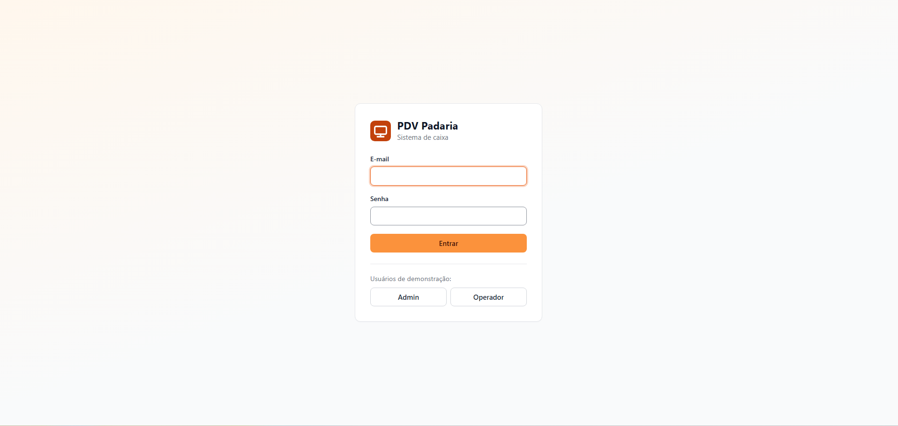
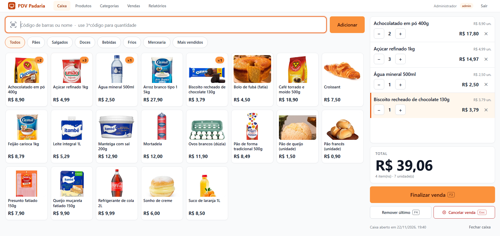
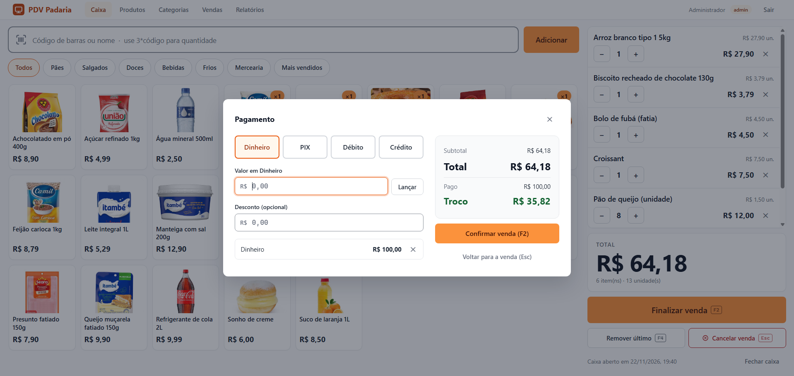
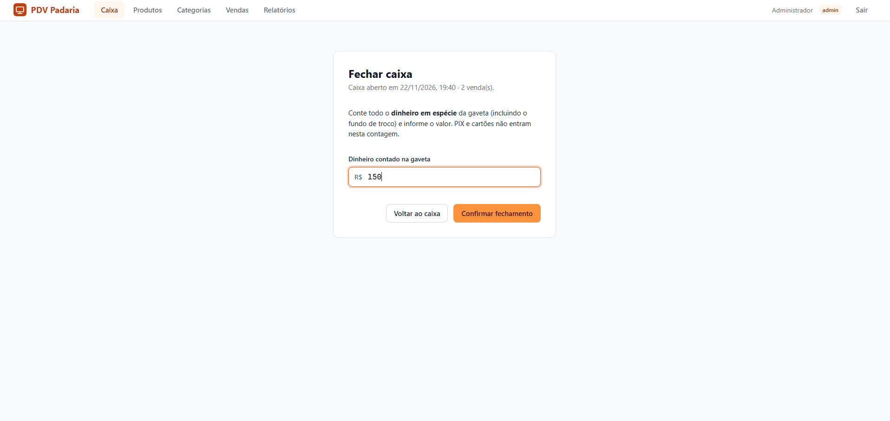
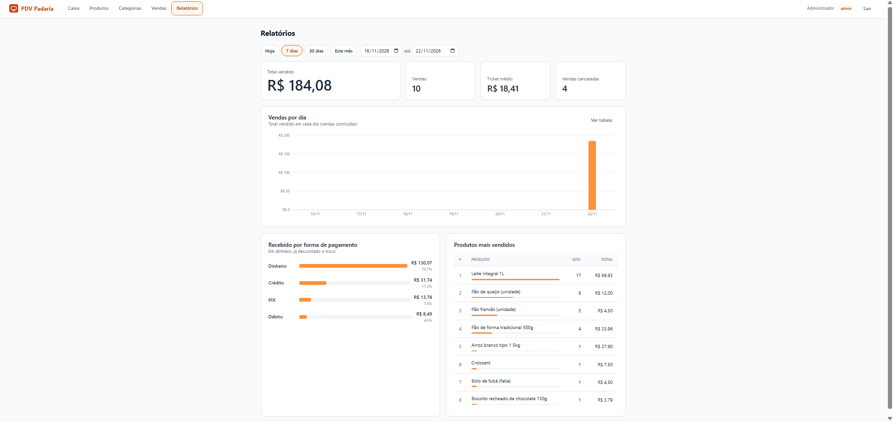
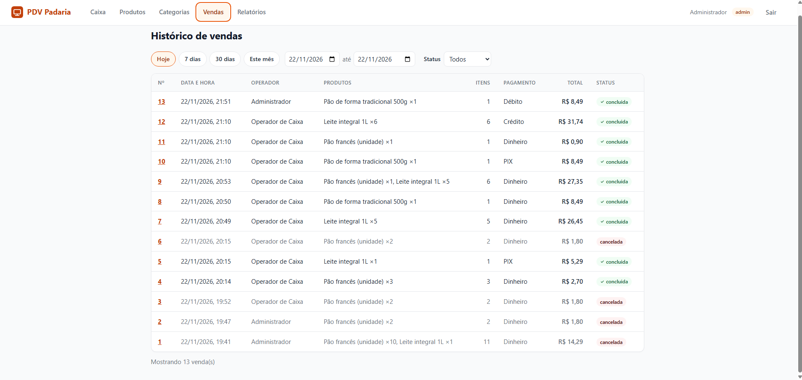

# PDV — Sistema de Caixa para Padaria e Mercado

Sistema de ponto de venda (PDV) completo: abertura e fechamento de caixa, vendas com leitor
de código de barras, pagamento com troco, controle de estoque, histórico com cancelamento e
relatórios com gráficos. Backend em **FastAPI + PostgreSQL** e frontend em **React**.

O foco do projeto é a **confiabilidade das regras de negócio de um caixa**: uma venda nunca
fica pela metade, o estoque nunca fica negativo (mesmo com dois caixas vendendo o último item
ao mesmo tempo) e os valores em dinheiro são sempre exatos.

## Funcionalidades

**Caixa (operador e admin)**
- Abertura com fundo de troco e fechamento "às cegas", com o valor esperado e a diferença
- Leitura por código de barras com o campo sempre em foco, quantidade com `5*código` e busca por nome
- Atalhos de teclado: **F2** finaliza, **F4** remove o último item, **Esc** cancela a venda
- Pagamento em dinheiro, PIX, débito e crédito, inclusive combinados, com troco calculado na hora

**Administração (admin)**
- Cadastro de produtos com busca, desativação e reativação
- Histórico de vendas com filtro por período e status, produtos de cada venda, detalhes e
  cancelamento
- Relatórios: total vendido, ticket médio, vendas por dia, formas de pagamento e produtos mais vendidos

**Segurança**
- Login com JWT, senhas com bcrypt e controle de acesso por perfil (admin e operador)

## Telas

| Login | Caixa |
|---|---|
|  |  |

| Pagamento com troco | Fechamento do caixa |
|---|---|
|  |  |

| Relatórios | Histórico de vendas |
|---|---|
|  |  |

## Tecnologias

| Camada | Tecnologias |
|---|---|
| Backend | Python 3.14, FastAPI, SQLAlchemy 2, Alembic, PostgreSQL, Pydantic, PyJWT, bcrypt |
| Frontend | React 19, Vite, React Router, Axios, Recharts |
| Qualidade | pytest (backend), Vitest e ESLint (frontend), Ruff (lint e formatação do Python) |
| Infraestrutura | Docker e Docker Compose (banco e backend) |

## Estrutura do projeto

```
pdv/
├── docker-compose.yml        banco + backend
├── backend/
│   ├── app/
│   │   ├── core/             configuração, conexão com o banco, segurança, erros
│   │   ├── models/           tabelas (SQLAlchemy)
│   │   ├── schemas/          formatos de entrada e saída da API (Pydantic)
│   │   ├── services/         regras de negócio
│   │   ├── routers/          endpoints (só recebem, delegam e respondem)
│   │   └── main.py
│   ├── alembic/              migrations
│   ├── scripts/seed.py       dados de exemplo
│   └── tests/                testes com pytest
└── frontend/
    └── src/
        ├── api/              chamadas à API (Axios)
        ├── components/       componentes reutilizáveis (modal, gráficos, filtros)
        ├── contexts/         sessão do usuário (AuthProvider)
        ├── hooks/            hooks próprios (atalhos, consultas)
        ├── pages/            telas: login, caixa e admin
        └── utils/            dinheiro, datas, mensagens de erro
```

## Como rodar

Há duas formas de subir o **banco e o backend**: com Docker ou instalando tudo localmente.
O **frontend** roda com `npm run dev` nas duas.

### Opção 1: com Docker

Pré-requisito: [Docker Desktop](https://www.docker.com/products/docker-desktop/).

```cmd
copy .env.example .env
```

Edite o `.env` da raiz e troque o `JWT_SECRET_KEY` por uma chave gerada com:

```cmd
python -c "import secrets; print(secrets.token_urlsafe(48))"
```

Suba o banco e a API. As migrations rodam sozinhas na subida:

```cmd
docker compose up -d --build
docker compose exec backend python -m scripts.seed
```

- API: http://localhost:8000/docs
- Banco: `localhost:5433`, com usuário, senha e banco do `.env`. A porta é 5433 para não
  conflitar com um PostgreSQL instalado na máquina.

Comandos úteis:

```cmd
docker compose ps                  situação dos containers
docker compose logs -f backend     logs da API
docker compose down                para tudo (os dados do banco são mantidos)
docker compose down -v             para tudo e APAGA os dados do banco
```

### Opção 2: sem Docker

Pré-requisitos: Python 3.12+ (testado com 3.14) e PostgreSQL com um banco vazio chamado `pdv`.

```cmd
cd backend
python -m venv .venv
.venv\Scripts\activate
pip install -r requirements.txt
copy .env.example .env
```

No `backend\.env`, ajuste o usuário e a senha do PostgreSQL em `DATABASE_URL` e gere uma
chave para `JWT_SECRET_KEY` (comando na opção 1). Depois:

```cmd
alembic upgrade head
python -m scripts.seed
uvicorn app.main:app --reload
```

### Frontend

Pré-requisito: Node.js 20+. Com a API rodando por qualquer uma das opções acima:

```cmd
cd frontend
npm install
npm run dev
```

Acesse http://localhost:5173. Se a API estiver em outro endereço, copie
`frontend\.env.example` para `frontend\.env` e ajuste `VITE_API_URL`.

### Usuários de teste

Criados pelo script de seed, junto com 20 produtos de padaria e mercado:

| Perfil   | E-mail           | Senha       |
|----------|------------------|-------------|
| admin    | admin@pdv.com    | admin123    |
| operador | operador@pdv.com | operador123 |

A tela de login tem atalhos para preencher esses usuários.

## Testes

**Backend:** 72 testes com pytest num PostgreSQL de verdade.

Crie um banco vazio `pdv_test` no mesmo servidor do `DATABASE_URL`. Ele é apagado e recriado a
cada execução. Por segurança, o `conftest.py` se recusa a rodar se o nome do banco não
terminar em `_test`.

```cmd
cd backend
pip install -r requirements-dev.txt
pytest -v
```

Para usar outro banco, defina `TEST_DATABASE_URL` no `backend\.env`.

Cobertura: venda com sucesso, venda sem estoque (tudo ou nada), troco, pagamento insuficiente,
PIX acima do total, cancelamento devolvendo estoque, operador tentando cancelar, fechamento de
caixa, relatórios, filtros por fuso horário, CORS, venda simultânea do último item,
categorias, mais vendidos, migrations em dia com os models e seed.

**Frontend:** 46 testes com Vitest para as contas em dinheiro, o carrinho, o pagamento, as
datas e o resumo de produtos do histórico.

```cmd
cd frontend
npm test
npm run lint
```

## Endpoints da API

A documentação interativa completa fica em `/docs` (Swagger). Para chamar as rotas protegidas,
faça `POST /auth/login`, copie o `access_token` e cole no botão **Authorize**.

| Método | Rota | Acesso | Descrição |
|---|---|---|---|
| POST | `/auth/login` | público | Login, devolve o token JWT |
| GET | `/auth/me` | logado | Usuário dono do token |
| GET / POST / PATCH | `/usuarios` | admin | Gestão de usuários (desativação em vez de exclusão) |
| GET | `/categorias` | logado | Categorias na ordem das abas do caixa |
| POST / PATCH / DELETE | `/categorias` | admin | Cadastro, edição e desativação |
| GET | `/produtos` | logado | Lista, com busca por nome ou código e filtro `categoria_id` |
| GET | `/produtos/mais-vendidos` | logado | Mais vendidos dos últimos `dias` (padrão: 30) |
| GET | `/produtos/codigo/{codigo}` | logado | Busca pelo código de barras (leitor do caixa) |
| POST / PATCH / DELETE | `/produtos` | admin | Cadastro, edição e desativação |
| POST | `/caixa/abrir` | logado | Abre o caixa do usuário |
| GET | `/caixa/atual` | logado | Caixa aberto com resumo parcial (ou `null`) |
| POST | `/caixa/fechar` | logado | Fecha e calcula o esperado e a diferença |
| POST | `/vendas` | logado | Registra a venda e dá baixa no estoque |
| GET | `/vendas` | logado | Histórico por período (o operador vê só as próprias) |
| GET | `/vendas/{id}` | logado | Detalhes da venda |
| POST | `/vendas/{id}/cancelar` | admin | Cancela e devolve os itens ao estoque |
| GET | `/relatorios/vendas` | admin | Totais, ticket médio, ranking e vendas por dia |

## Decisões técnicas

### Venda e baixa de estoque na mesma transação
Uma venda grava várias coisas: a venda, os itens, os pagamentos e a baixa de estoque de cada
produto. Tudo isso vai para o banco em **um único commit**. Se qualquer passo falhar (um
produto sem estoque, um pagamento insuficiente, uma queda de conexão), é feito rollback e
**nada** fica gravado. Assim nunca existe venda sem baixa de estoque, nem estoque baixado por
uma venda que não aconteceu.

### Trava de linha (`SELECT ... FOR UPDATE`) contra venda simultânea
Sem a trava, dois caixas vendendo o último bolo ao mesmo tempo leriam os dois "estoque = 1",
os dois venderiam, e o estoque terminaria em 0 com duas unidades vendidas. A CHECK constraint
do banco nem perceberia, porque nenhum valor ficou negativo. Com `with_for_update()`, a segunda
venda espera a primeira terminar e então vê o estoque atualizado.

Há um teste que reproduz exatamente esse cenário com duas threads. Ao remover a trava para
conferir, o teste falhou em todas as execuções (as duas vendas passaram). Os produtos são sempre travados **em ordem de id**, o que impede
que duas vendas fiquem esperando uma pela outra (deadlock).

### `Decimal` no backend e centavos inteiros no frontend
`float` não representa valores decimais com exatidão: `0.1 + 0.2 = 0.30000000000000004`. Em
dinheiro, esse erro aparece em totais e trocos. Por isso:
- **no banco**, valores são `NUMERIC(10, 2)`;
- **no Python**, são `Decimal`;
- **na API**, trafegam como texto (`"8.49"`), para nenhum intermediário converter para float;
- **no frontend**, as contas são feitas em centavos inteiros (R$ 8,49 = 849).

### Preço copiado para o item da venda
Cada item guarda o `preco_unitario` cobrado no momento da venda. Mudar o preço de um produto
amanhã não altera vendas, relatórios ou fechamentos passados.

### Regras protegidas também pelo banco
Além da validação no código, o banco tem a última palavra:
- CHECK constraints: estoque não negativo, troco só em dinheiro, `total = subtotal - desconto`,
  `subtotal = quantidade × preço`;
- um **índice único parcial** (`WHERE fechado_em IS NULL`), que garante um único caixa aberto
  por usuário mesmo com duas aberturas simultâneas.

### Outras decisões
- **Exclusão lógica:** produtos e usuários são desativados, não apagados, para preservar o
  histórico de vendas.
- **Perfil lido do banco a cada requisição:** o token JWT leva só o id do usuário. Desativar
  alguém ou trocar seu perfil vale na hora, sem esperar o token expirar.
- **Login sem revelar e-mails:** a mesma mensagem e o mesmo tempo de resposta para e-mail
  inexistente e senha errada.
- **Fechamento "às cegas":** o operador informa o dinheiro contado antes de ver o valor
  esperado, para a contagem não ser ajustada para bater.
- **Cancelamento só com o caixa aberto:** cancelar uma venda de um caixa já fechado mudaria um
  fechamento já conferido.
- **Fuso horário nos filtros:** "vendas do dia 05" segue o horário de Brasília. Uma venda às
  23h não cai no dia seguinte, como aconteceria em UTC.
- **Regras de negócio nos services:** os routers não têm regra nenhuma, e os services lançam
  exceções próprias (`RegraNegocio`, `Conflito`...), convertidas em HTTP num único lugar.
- **Testes em PostgreSQL, não em SQLite:** o que mais importa testar (travas, índice parcial,
  constraints) só existe de verdade no PostgreSQL. O esquema de testes é criado pelas próprias
  migrations, então os testes também validam as migrations.
- **Telas de admin carregadas sob demanda** (`React.lazy`): o operador não baixa o código dos
  relatórios nem a biblioteca de gráficos.

### Limitações conhecidas e próximos passos
- **Token no `localStorage`:** é simples e sobrevive ao recarregar a página, mas pode ser lido
  por um script injetado (XSS). A alternativa mais segura é um cookie `httpOnly`.
- **Venda só por unidade:** a quantidade é inteira. Produtos vendidos por peso (pão por kg)
  precisariam de quantidade decimal.
- **Sem tela de usuários no frontend:** a gestão de usuários existe só na API.
- **Ideias futuras:** emissão de cupom, integração com balança e TEF, e testes de interface
  ponta a ponta (Playwright).
